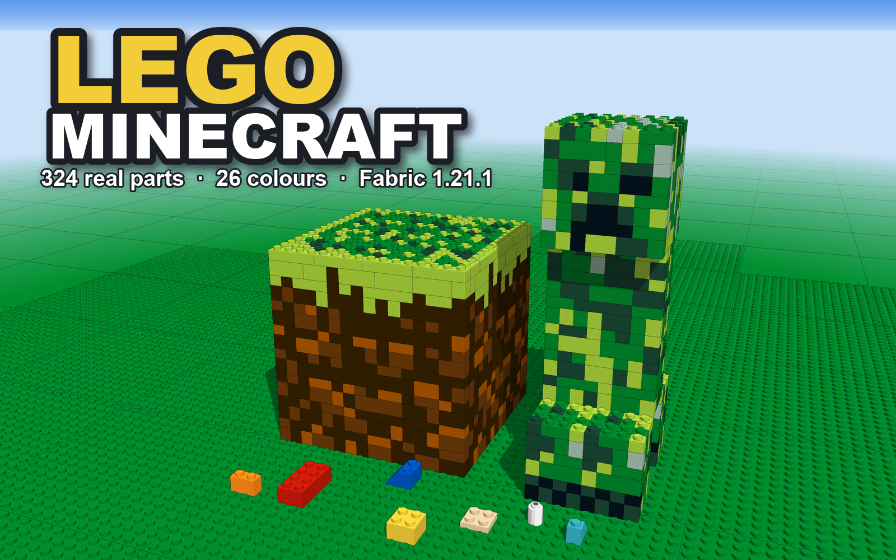

# Lego Minecraft



在 Minecraft 里用乐高官方零件 1:1 拼搭作品的 Fabric 模组（Minecraft 1.21.1）。每个零件对应乐高官方设计号，尺寸参照 LDraw 零件库建模，可以照着官方说明书一步步拼出现实中的乐高套装。

*A Fabric mod (Minecraft 1.21.1) for building with real LEGO® parts at 1:1 scale: 324 official parts in 26 colours, stud snapping, multi-part blocks, Technic pins and axles, bars and clips. Build real sets by following the official instructions.*

比例：1 个凸点 = 1 格宽，1 块砖（3 块板）= 1 格高。客户端和服务端都需要安装。

## 功能

- 内置 **324 种乐高官方零件**：砖、板、光面砖、斜面、弧面、倒斜面、圆砖、托架、侧面凸点砖、面板、杆、夹子，以及机械组的梁、销、十字轴、轴套、齿轮
- **26 种乐高官方实色**，真实生产过的零件另有透明色和蛋白石色，共约 9000 个零件颜色变体
- 悬停可查看设计号和乐高元件号（说明书零件表上的 7 位数字），在创造模式搜索栏输入元件号可直接找到对应颜色的零件
- **凸点吸附**：凸点插进反凸点，「咔哒」一声扣上；上方、下方、侧面都能拼接，支持倒扣、侧装等任意朝向
- 一个零件可以跨多个方块格，同一格内也能放多个零件，相邻零件互不遮挡
- **杆与夹子**：夹子可以夹住杆和把手，杆可以插进夹子、圆环和空心凸点；空手潜行并按住右键左右拖动，可让零件绕杆每次旋转 90°
- 侧面凸点砖和托架可以朝侧面继续拼搭
- **机械组**零件按 8 mm 孔位网格安装：销和十字轴插进孔里，梁套在销上，齿轮和轴套套在十字轴上
- 原版方块相当于一块 1×1 砖，可以直接放在乐高凸点上，没对齐方块网格时也能放
- 点击创造物品栏里的零件样品，会列出该零件的全部颜色，左键拿一组，右键拿一个
- 人仔头、上身、腿、雕像和可召唤的会走动的乐高人仔，以及动物、植物、花、家具、门窗、灯、缆线、织物、标牌等装饰方块
- 所有零件都能在生存模式中用原版材料合成，白色零件加染料即可染色

## 使用方式

- **拼搭**：手持零件右键其他零件的凸点或底面，零件会自动吸附到最近的位置
- **整体拿起**：空手潜行右键，把通过真实连接拼在一起的整个作品拿成一个「乐高模型」物品；放置时显示半透明预览，放不下时预览变红
- **乐高移动工具**：右键把刚放下的零件或模型向右移一个凸点，潜行右键向左移，抬头或低头时上下移一层板高；手持时可用方向键前后左右移动，PageUp / PageDown 上下移动；右键其他乐高零件可以改为移动它

## 安装

- Minecraft 1.21.1、Fabric Loader ≥ 0.19.5、Fabric API、Java 21+
- LibMultiPart、LibBlockAttributes、LibNetworkStack 已内置于模组中，无需另外安装
- 可选联动：[Jade](https://modrinth.com/mod/jade)，显示零件信息

## 从源码构建

```bash
./gradlew build        # Windows: .\gradlew.bat build
./gradlew runClient    # 启动开发客户端
```

输出：`build/libs/legominecraft-<version>.jar`

零件目录在 `lego_catalog.json`，修改后运行：

```bash
python scripts/make_elements.py
python scripts/generate_data.py
```

## 许可证

本模组代码以 [MIT](LICENSE) 许可证发布。

内置的 [LibMultiPart](https://github.com/AlexIIL/LibMultiPart)、LibBlockAttributes、LibNetworkStack 遵循各自的许可证（MPL-2.0）。零件尺寸参考 [LDraw](https://www.ldraw.org/) 零件库，零件与颜色数据参考 [Rebrickable](https://rebrickable.com/)。

## 声明

LEGO® 是乐高集团（LEGO Group）的注册商标。本模组为玩家自制作品，与乐高集团无任何关联，也未获其授权或认可。

*LEGO® is a trademark of the LEGO Group, which does not sponsor, authorize or endorse this project.*
